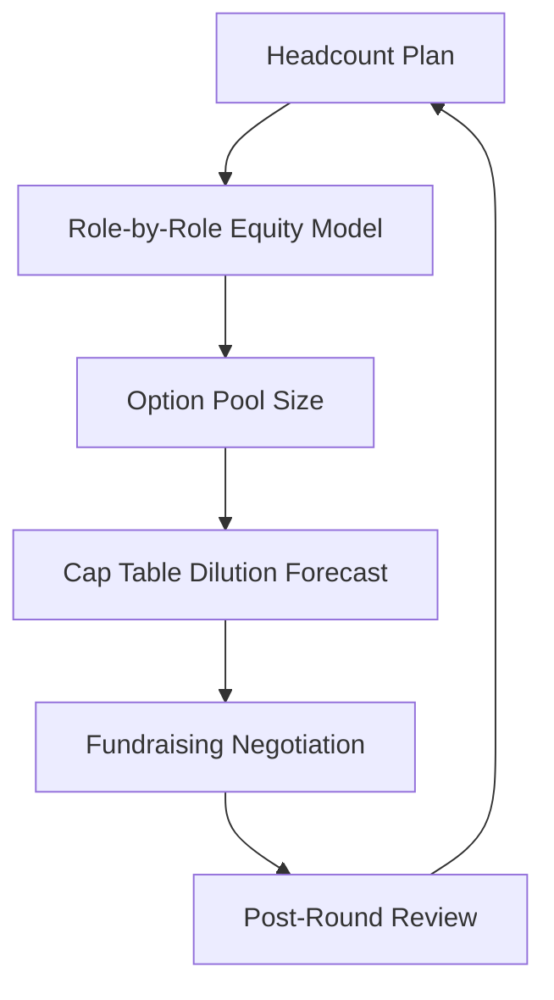

---
title: Equity and Option Pool Planning
repo: founder-operating-system
primary_keyword: Business Operations
secondary_keywords:
- Startup
- Fundraising
- CEO
slug: equity-and-option-pool-planning
word_count_target: 1200
commit_type: 'docs(founder):'---

# Equity and Option Pool Planning for Founders

## Introduction

Equity and option pool planning is a core **Business Operations** decision for any founder building a venture-backed company. It affects ownership, hiring power, investor negotiations, and long-term control. For a **Startup**, the cap table is not just a legal artifact; it is a strategic operating system that shapes how talent is recruited, how rounds are priced, and how a **CEO** preserves room to lead the company through multiple financing events.

Founders often treat equity as a one-time legal task. That is a mistake. Option pool sizing, dilution timing, and allocation strategy should be planned alongside fundraising, hiring forecasts, and milestone execution. If the plan is weak, the company can end up over-diluted early, under-incentivized for key hires, or forced into painful renegotiations during a financing round.

## Problem Statement

Most early-stage companies make one of four mistakes with equity and option pool planning:

1. They create an option pool that is too small, then run out of grants before reaching product-market fit.
2. They create a pool that is too large, causing unnecessary founder dilution before hiring demand exists.
3. They fail to model dilution across multiple rounds, which creates surprises during **Fundraising**.
4. They allocate equity reactively instead of using a consistent framework tied to role seniority and market norms.

These mistakes create real operational problems. A **Startup** may lose candidates because it cannot offer competitive grants. A **CEO** may discover that a future round requires expanding the pool at the worst possible time, increasing dilution just before an investor closes. In extreme cases, poor planning weakens founder motivation and makes future liquidity outcomes less attractive for the team.

The core challenge is that equity decisions are interdependent. A hiring plan affects option pool size. The option pool affects dilution. Dilution affects negotiation leverage in fundraising. Fundraising affects the company’s ability to hire. Without a structured model, founders are guessing.

## Solution

The solution is to treat equity and option pool planning as a forecasting exercise tied to the company’s operating plan.

Start with three inputs:

- Headcount plan for the next 12 to 24 months
- Compensation philosophy for cash vs. equity
- Fundraising roadmap and expected round structure

Then determine the option pool size based on planned hires, not intuition. For example, if a company expects to hire 12 people before the next priced round, it should estimate grants for each role category: engineering, product, sales, operations, and leadership. The pool should include a buffer for replacements, promotions, and strategic hires.

A practical approach:

- Use market data to define grant ranges by role and stage
- Reserve more equity for early, high-impact hires
- Keep refresh grants and promotions in the forecast
- Review the pool before each financing event

The founder should also decide how dilution will be shared. In many cases, founders accept dilution from both the option pool and the new investor round because the pool is often expanded pre-money or at closing. That means the founder needs to understand whether the pool increase is being created before or after the investment is priced.

A disciplined **Business Operations** process should answer:

- How many hires are planned before the next round?
- Which roles are mission-critical?
- What is the target ownership range for each role?
- How much dilution is acceptable for founders and early employees?
- What happens if hiring slows or accelerates?

The result is a cap table that supports execution rather than constraining it.

## Architecture or Framework

A useful framework for equity and option pool planning is the **Hire, Grant, Dilute, Review** model.

### 1. Hire
Build a hiring plan for the next 12 to 18 months. Break it down by function and timing. A **Startup** should not size an option pool for a hypothetical team of 50 if it only plans to hire 8 people in the next year.

### 2. Grant
Assign equity ranges based on role seniority, impact, and stage. For example:

- Early engineer: smaller grant than founding engineer
- First sales leader: larger grant if revenue ownership is critical
- Senior operator or executive: grant should reflect scope and risk

The goal is consistency. A **CEO** should avoid ad hoc promises that create internal fairness issues.

### 3. Dilute
Model the dilution impact of the option pool and the next financing round. Include:
- Current founder ownership
- Existing employee grants
- Unallocated pool
- Expected investor ownership after financing

This is where many teams make errors. They look at the option pool in isolation instead of as part of total dilution.

### 4. Review
Revisit the model before each hiring wave and each financing event. If hiring is slower than expected, the pool may not need expansion. If the company is growing faster, the pool may need to be topped up to avoid future shortages.

For example, a company raising a Series A may need to expand the option pool to support executive hiring, but the founder should negotiate the timing and size carefully. Small percentage changes can materially affect founder outcomes over time.

## Benefits

A well-designed equity and option pool plan creates measurable advantages.

### Better hiring outcomes
Candidates at startup stage often compare total compensation, not just salary. A clear equity strategy helps the company compete for talent while staying within budget.

### Cleaner fundraising
Investors prefer companies with a realistic pool and a defensible hiring model. A founder who can explain the option pool in terms of upcoming hires and role priorities appears more prepared during **Fundraising**.

### Stronger founder control
When dilution is planned intentionally, founders can preserve enough ownership to remain motivated through later rounds. This matters especially for a **CEO** who must maintain leadership authority through growth and board governance.

### Improved internal fairness
A documented grant framework reduces conflict. Employees are more likely to trust the system when grants are tied to role, stage, and scope rather than personal negotiation.

### More accurate planning
Option pool planning is also a forecasting tool. It helps finance and people operations estimate compensation expense, hiring capacity, and the timing of future capital needs.

## Challenges

Even with a framework, equity planning has real trade-offs.

### Valuation timing
The size of the option pool can affect pre-money valuation mechanics. Founders should understand whether the pool is being added before or after the round is priced, since this changes dilution.

### Market volatility
Equity norms shift by market cycle, geography, and sector. A **Startup** in AI infrastructure may need different grant levels than a SaaS company at the same stage.

### Retention risk
If grants are too small, the company may struggle to retain talent. If grants are too generous, founder dilution can become excessive.

### Legal and administrative complexity
Option grants require board approval, vesting schedules, valuation compliance, and clear documentation. Poor administration creates risk later, especially during diligence.

### Psychological pressure
Founders may over-focus on preserving ownership and under-invest in hiring. That can slow growth more than dilution would. A strong **Business Operations** mindset balances ownership protection with execution needs.

### Misaligned assumptions
One founder may assume aggressive hiring, while another expects a lean team. If the option pool is sized without a shared operating plan, disputes are likely.

## Future Opportunities

Equity and option pool planning is becoming more data-driven. Several improvements are emerging:

### Scenario-based cap table modeling
Founders can build multiple cases for hiring speed, fundraising timing, and headcount growth. This makes it easier to compare dilution outcomes before making commitments.

### Automated compensation benchmarks
More companies are using market datasets to calibrate grants by role and geography. This improves consistency and reduces guesswork.

### Integrated finance and HR planning
As startups mature, equity planning should connect with budget forecasts, hiring plans, and board reporting. That creates a more complete operating model.

### Better employee education
Founders who explain how equity works build trust. Employees who understand vesting, dilution, and exit scenarios are less likely to misinterpret their ownership.

### More disciplined founder governance
A strong **CEO** can use equity planning as part of broader governance: setting principles for grants, refreshes, promotions, and hiring approvals. That discipline improves decision-making as the company scales.

## Conclusion

Equity and option pool planning is not a side task. It is a foundational part of **Business Operations** that influences hiring, fundraising, and founder control. The best approach is to size the pool from a real hiring plan, model dilution across future rounds, and review the cap table before every major financing or headcount change.

For a **Startup**, the right plan creates flexibility. For a **CEO**, it preserves strategic control. For investors, it signals maturity. Founders who treat equity as an operating discipline, not a one-time legal event, are better positioned to build durable companies with aligned teams and fewer surprises.

## Related Reading

- (pending)