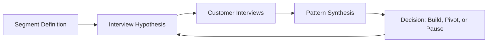

---
title: Customer Discovery Interview Playbook
repo: founder-operating-system
primary_keyword: Product Strategy
secondary_keywords:
- Startup
- Growth Strategy
- Founder
slug: customer-discovery-interview-playbook
word_count_target: 1200
commit_type: 'docs(founder):'---

# Customer Discovery Interview Playbook

## Introduction

A strong **Product Strategy** starts with evidence, not assumptions. For a **Founder**, customer discovery interviews are one of the fastest ways to test whether a problem is real, urgent, and worth solving. They help a **Startup** avoid building features that sound compelling internally but fail to create demand in the market.

This playbook gives founders a practical process for running customer discovery interviews that produce usable insights for roadmap decisions, positioning, and early **Growth Strategy**. The goal is not to ask customers what they want to build. The goal is to understand how they currently work, where friction exists, what they have already tried, and what triggers action.

## Problem Statement

Many early teams treat interviews like informal sales conversations. They ask leading questions such as “Would you use this?” or “How much would you pay for this?” Those questions usually produce polite but unreliable answers. Customers often describe hypothetical interest, not actual behavior.

The result is predictable:

- Teams overestimate demand.
- Roadmaps get shaped by opinions instead of evidence.
- Founders confuse enthusiasm with intent to buy.
- Product Strategy becomes reactive, not intentional.

Another common failure is interviewing the wrong people. A startup may speak with users who are friendly but not decision-makers, or with prospects who do not experience the pain frequently enough. Without a clear target segment, interviews generate noise instead of signal.

The real problem is not lack of customer conversations. It is lack of a repeatable interview system that turns conversations into decisions.

## Solution

A customer discovery interview playbook should standardize four things: who to interview, what to ask, how to analyze, and how to act on the findings.

### 1. Define the target segment

Start by narrowing the audience. A useful segment has a shared job, workflow, and pain pattern. For example, “B2B SaaS founders managing early customer support manually” is more useful than “people who need automation.”

Define:

- Role and seniority
- Company size or usage context
- Frequency of the problem
- Current workaround
- Buying authority

This keeps interviews focused on a specific wedge, which improves the quality of the Product Strategy.

### 2. Build an interview hypothesis

Before speaking to anyone, write down what you believe. A simple template:

- We believe [segment] struggles with [problem].
- They currently solve it by [workaround].
- The cost of the problem is [time, money, risk, missed revenue].
- We will know this is real if [observable behavior].

This hypothesis shapes the interview and prevents vague note-taking.

### 3. Ask about the past, not the future

The best questions reveal behavior. Ask about recent events, not opinions.

Examples:

- “Tell me about the last time this happened.”
- “What triggered you to look for a solution?”
- “What did you try first?”
- “What happened after that?”
- “How did you decide it was worth fixing?”

Avoid:

- “Would you use this?”
- “Do you like this idea?”
- “How much would you pay?”
- “Would your team buy this?”

Past behavior is a stronger indicator of product-market fit than hypothetical interest.

### 4. Capture evidence of urgency

Not all pain matters. A problem becomes strategically important when it creates urgency. Look for signals such as:

- Repeated manual work
- Revenue loss
- Compliance risk
- Customer churn
- Executive escalation
- Slack or email chaos
- Workarounds that consume team time

If the pain does not trigger action, it may not be a priority.

### 5. Synthesize patterns, not anecdotes

One interview is a story. Ten interviews create a pattern. After each round, cluster responses into themes:

- Common triggers
- Common workarounds
- Common objections
- Common decision criteria
- Common language used by customers

Use a simple scoring system to compare signals across interviews:

- Problem frequency: 1–5
- Severity: 1–5
- Current workaround quality: 1–5
- Willingness to change: 1–5
- Buying urgency: 1–5

This turns qualitative data into a decision aid for Product Strategy.

## Architecture or Framework

A practical customer discovery system can be run in four stages.

### Stage 1: Segment Definition

Choose one narrow segment and one core problem. If the segment is too broad, interview feedback becomes inconsistent.

### Stage 2: Interview Hypothesis

Document the expected pain, current workaround, and likely trigger. This becomes the benchmark for learning.

### Stage 3: Customer Interviews

Run 8–15 interviews per segment. Use a consistent script, but allow room for follow-up questions. Record interviews when possible and take structured notes.

A useful interview structure:

1. Context: role, workflow, responsibilities
2. Trigger: what caused the last instance of the problem
3. Current process: how they handle it now
4. Pain: what breaks, slows down, or costs money
5. Alternatives: tools, spreadsheets, people, or manual workarounds
6. Decision: what would make them change
7. Language: exact words they use to describe the problem

### Stage 4: Pattern Synthesis

After each batch, compare notes and decide whether the problem is:

- Strong enough to build
- Real but too weak to prioritize
- Real but in the wrong segment
- Real and urgent, but needs a different solution shape

This framework keeps the team honest and reduces the risk of building from intuition alone.

## Benefits

A disciplined interview process improves both strategic and operational outcomes.

### Better Product Strategy

Founders can prioritize problems that are frequent, painful, and tied to measurable business outcomes. That leads to clearer product bets and tighter positioning.

### Faster learning cycles

A startup can validate or invalidate assumptions before investing in engineering. That shortens the path from idea to evidence.

### Stronger messaging

Customer language from interviews often becomes the best copy for landing pages, demos, and outbound sales. The exact phrases customers use are usually more effective than internal terminology.

### Improved roadmap focus

When interviews reveal the real job-to-be-done, teams stop chasing feature requests that do not address the core pain.

### Better founder alignment

Interview evidence helps leadership teams make decisions with less debate and more clarity. It gives the Founder a shared reference point for prioritization.

## Challenges

Customer discovery is useful, but it is easy to do poorly.

### Interview bias

Founders often hear what they want to hear. To reduce bias, use a standard script, ask open-ended questions, and avoid explaining the solution too early.

### Recruiting the right people

Finding qualified interviewees takes effort. Use warm intros, customer communities, LinkedIn outreach, and existing user lists. If the segment is wrong, the data will be misleading.

### False positives from polite feedback

People may be encouraging without being committed. Always look for evidence of past action, not verbal support.

### Overfitting to a small sample

A few interviews can mislead if the sample is too narrow. Validate themes across multiple conversations before making major decisions.

### Confusing pain with priority

A problem can be real but still not important enough to solve now. Good Product Strategy requires ranking problems by urgency, not just existence.

## Future Opportunities

Customer discovery can become a repeatable operating system, not a one-time research task.

### Continuous discovery

Instead of interviewing only before launch, schedule monthly or biweekly conversations with target users. This keeps the team close to changing needs and market shifts.

### Interview-to-roadmap pipelines

Teams can connect interview themes directly to product planning. For example, top pain themes can feed into quarterly planning, while repeated objections can inform positioning experiments.

### AI-assisted synthesis

Founders can use AI tools to tag transcripts, cluster themes, and extract recurring language. The human role remains interpretation and judgment, but AI can reduce the time spent organizing notes.

### Better segmentation

As the company grows, interviews can reveal subsegments with different urgency, buying behavior, or workflow constraints. This helps refine the Growth Strategy and avoid one-size-fits-all product decisions.

### Stronger cross-functional use

Interview insights should inform not only product, but also sales, marketing, and customer success. When teams share the same customer evidence, execution becomes more coherent.

## Conclusion

Customer discovery interviews are one of the highest-signal tools in early-stage Product Strategy. They help founders separate real demand from polite curiosity, identify urgent problems, and choose which opportunities deserve engineering time.

The key is discipline: interview the right segment, ask about actual behavior, capture evidence of urgency, and synthesize patterns across conversations. When done well, customer discovery becomes a repeatable input into roadmap decisions, messaging, and market positioning.

For any Startup trying to build with confidence, the interview process is not just research. It is a decision system.

## Related Reading

- (pending)